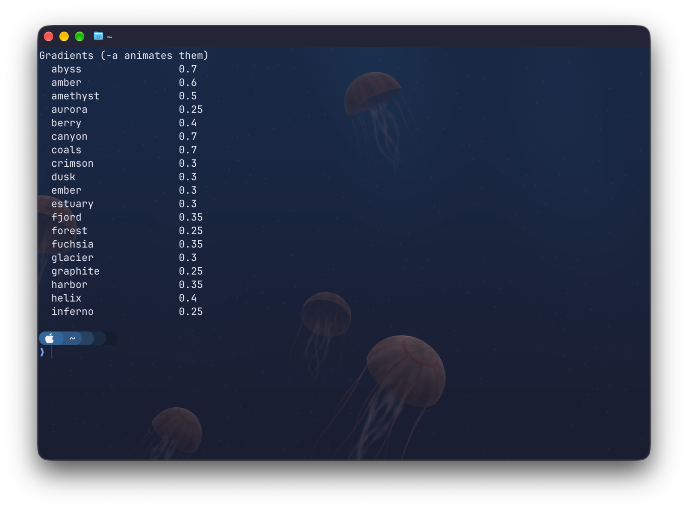
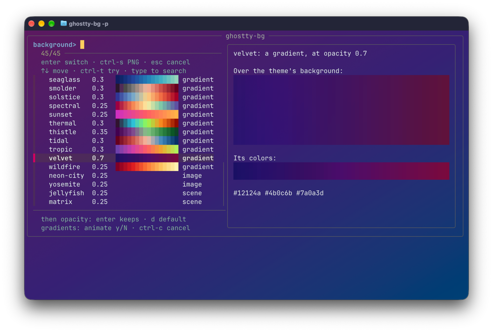
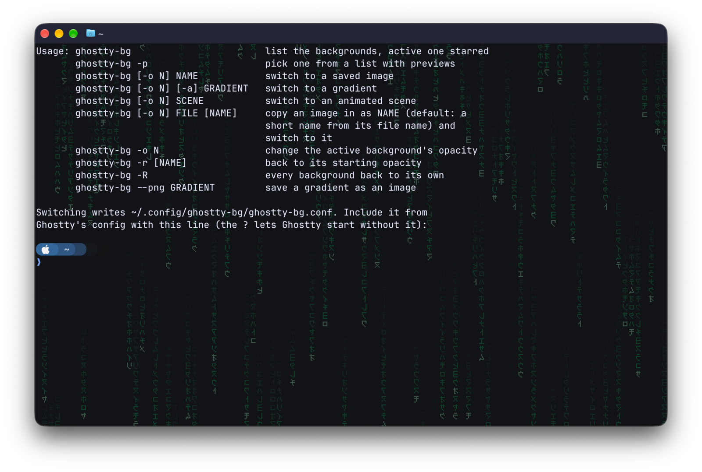
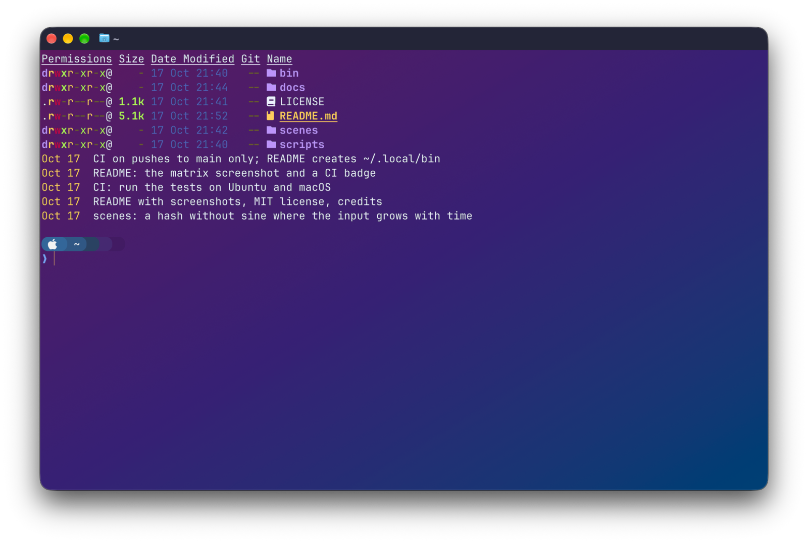
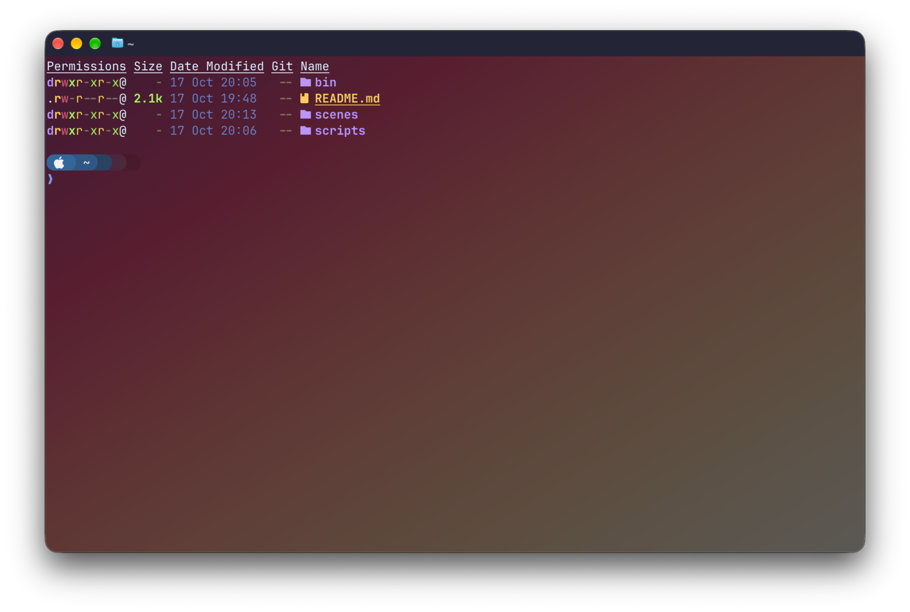

# ghostty-bg

[](https://github.com/pglockner/ghostty-bg/actions/workflows/test.yml)

Gradients, animated scenes and images as backgrounds for
[Ghostty](https://ghostty.org), switched from the command line or an fzf
picker with live color previews, while keeping your text readable.



- **41 gradients**, from deep (`orchid`, `velvet`, `coals`) to vivid
  (`wildfire`, `lagoon`, `prism`), still or animated with `-a`
- **Two animated scenes:** `jellyfish`, sea nettles drifting up through deep
  water, and `matrix`, slow, muted falling code
- **Your own images**, copied in from any format ImageMagick reads
- **A picker** (`ghostty-bg -p`) with color swatches and a preview of each
  gradient over your theme; ctrl-t tries one without leaving it
- **Readable text:** each gradient's bright end sits in the bottom-right
  corner, where text rarely goes; over bright gradients the theme's dim text
  colors are lightened just enough, keeping their hue; and a gradient pushed
  past the opacity where text stays readable says so
- **Automatic reload** with Ghostty 1.3 or later
- **PNG export** of any gradient, for apps that take a background image
- **macOS and Linux**





## Install

Needs Ghostty and bash (3.2 or later, so macOS's own works). fzf is needed
for the picker, and ImageMagick for importing images and `--png`;
everything else works without them.

```sh
brew install fzf imagemagick          # macOS
sudo apt install fzf imagemagick      # Debian, Ubuntu

git clone https://github.com/pglockner/ghostty-bg.git ~/projects/ghostty-bg
mkdir -p ~/.local/bin
ln -s ~/projects/ghostty-bg/bin/ghostty-bg ~/.local/bin/ghostty-bg
```

Then add this line to Ghostty's config file (cmd-, opens it on macOS,
ctrl-, on Linux); the `?` lets Ghostty start before the file exists:

```
config-file = ?~/.config/ghostty-bg/ghostty-bg.conf
```

## Use

| Command | Does |
|---|---|
| `ghostty-bg` | list the backgrounds, the active one starred |
| `ghostty-bg -p` | pick one in fzf, then set its opacity and animation |
| `ghostty-bg orchid` | switch to a gradient, scene or image by name |
| `ghostty-bg -o 0.4 wildfire` | switch, at an opacity remembered for next time |
| `ghostty-bg -a lagoon` | switch to a gradient whose colors flow |
| `ghostty-bg ~/Pictures/sky.jpg` | copy an image in and switch to it |
| `ghostty-bg -r` / `-R` | back to the starting opacity, for one or every background |
| `ghostty-bg --png dusk` | save a gradient as a 3840x2160 PNG in `~/Pictures/ghostty-bg/` |

`ghostty-bg -h` has the details.



## How it works

Gradients and scenes are Ghostty
[custom shaders](https://ghostty.org/docs/config/reference#custom-shader).
Ghostty hands a shader the finished screen, so ghostty-bg's shaders tint
only the pixels close to the theme's background color and leave text alone.
Each switch rewrites `~/.config/ghostty-bg/ghostty-bg.conf`, which names the
shader or image, and signals Ghostty to reload.

Over a bright gradient that isn't enough to keep dim text readable, so
ghostty-bg also writes lighter versions of the theme's dim palette colors
into that file, worked out from the gradient's colors and opacity. Deep
gradients leave the palette as it is.



State lives in `~/.config/ghostty-bg/` (under `$XDG_CONFIG_HOME` if set):
the config Ghostty includes, `shaders/`, the remembered `opacity` per
background, and `backgrounds/`, your images. Point `GHOSTTY_BG_IMAGES` at
another folder, or make `backgrounds/` a link to one, to keep images
elsewhere or sync them between machines.

## Add a scene

A scene is a GLSL file in `scenes/` that defines `mainImage`, the way
[Shadertoy](https://www.shadertoy.com) shaders do. ghostty-bg puts
`const float STRENGTH` (the opacity) in front of it; use it, and
`iBackgroundColor`, to tint only the background, as `scenes/matrix.glsl`
does. `scripts/test.sh` lints ghostty-bg, runs it against a throwaway
config folder, and compiles the shaders if `glslangValidator` is installed.

## Credits

- Most gradients are WezTerm's presets: the
  [colorgrad](https://github.com/mazznoer/colorgrad-rs) crate's ports of
  [d3-scale-chromatic](https://github.com/d3/d3-scale-chromatic)'s schemes,
  sampled, trimmed and renamed here. They include ColorBrewer's palettes:
  this product includes color specifications and designs developed by
  Cynthia Brewer (http://colorbrewer.org/). The viridis family comes from
  matplotlib.
- The scenes' noise uses Dave Hoskins'
  [hash without sine](https://www.shadertoy.com/view/4djSRW), Copyright (c)
  2014 David Hoskins, MIT License.
- `jellyfish` was inspired by Aleksandar Rodic's
  [WebGL jellyfish](https://akirodic.com/p/jellyfish/).

## License

MIT; see [LICENSE](LICENSE).
